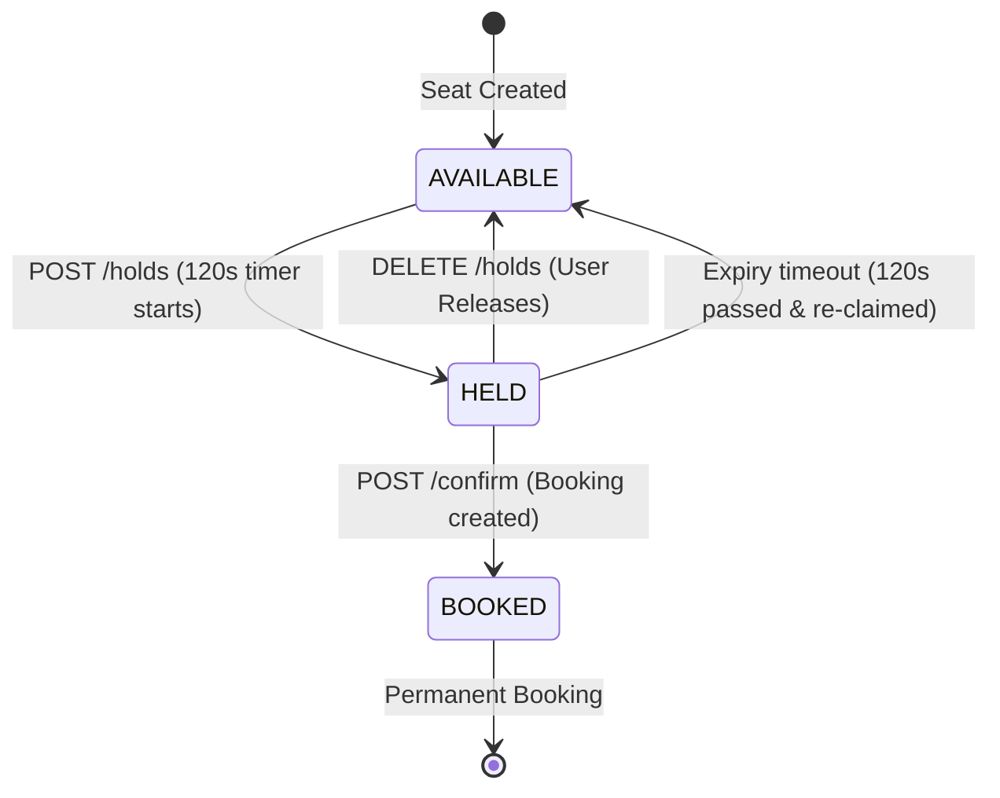
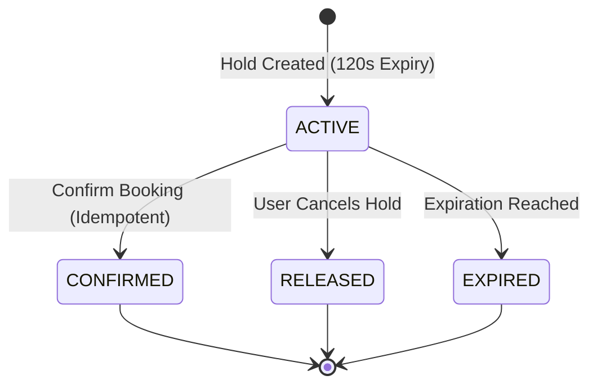

# Event Seat Booking System

A production-grade, full-stack **Event Seat Booking System** built from scratch using Node.js, Express (MVC Architecture), MongoDB with Mongoose, and a modern React (Vite + Tailwind CSS) frontend.

The system is engineered specifically to solve high-concurrency ticket reservation challenges: guaranteeing that two users can never claim the same seat simultaneously, enforcing strict 120-second server-authoritative hold expirations, ensuring idempotent booking confirmations, and providing multi-seat all-or-nothing atomic transactions with rollback protection.

---

## Table of Contents

1. [Project Overview](#project-overview)
2. [Key Features](#key-features)
3. [Technology Stack](#technology-stack)
4. [Complete Folder Structure](#complete-folder-structure)
5. [MVC Architecture Breakdown](#mvc-architecture-breakdown)
6. [Prerequisites](#prerequisites)
7. [MongoDB Configuration & Replica Set Setup](#mongodb-configuration--replica-set-setup)
8. [Environment Variable Configuration](#environment-variable-configuration)
9. [Installation & Setup](#installation--setup)
10. [Starting Backend & Frontend](#starting-backend--frontend)
11. [Running Automated Tests](#running-automated-tests)
12. [REST API Documentation (with Sample Payloads)](#rest-api-documentation)
13. [Database Models & Indexing Strategy](#database-models--indexing-strategy)
14. [Seat & Hold State Transitions](#seat--hold-state-transitions)
15. [Concurrency & Transaction Architecture](#concurrency--transaction-architecture)
16. [Idempotency Strategy](#idempotency-strategy)
17. [Authentication & Authorization](#authentication--authorization)
18. [Beginner-Friendly Code Explanations](#beginner-friendly-code-explanations)
19. [Troubleshooting Guide](#troubleshooting-guide)
20. [Known Limitations & Architecture Decisions](#known-limitations--architecture-decisions)
21. [Production Deployment Guide (Vercel & Render)](#production-deployment-guide-vercel--render)

---

## 1. Project Overview

In traditional ticketing systems, high-traffic ticket on-sales often suffer from race conditions: two customers click on seat "A4" at the exact same millisecond, and both get charged while only one seat exists (overselling).

This project demonstrates a mathematically sound, transactionally secure approach:
- **Server Authority**: Seat prices, expiration timestamps, and ownership checks are strictly computed and enforced on the server. Client input prices and timers are purely visual and never trusted.
- **Atomic Multi-Seat Holds (1–4 seats)**: When a user selects multiple seats, the allocation succeeds completely or rolls back entirely without leaving partial holds.
- **120-Second Expiring Holds**: Seats are held for exactly 120 seconds. If confirmation is not completed before expiry, seats immediately become available for other customers.
- **Zero Race Conditions**: Employs conditional atomic MongoDB queries (`$or: [{ status: 'AVAILABLE' }, { status: 'HELD', holdExpiresAt: { $lt: now } }]`) combined with MongoDB Replica Set multi-document ACID transactions.
- **Idempotent Confirmations**: Retrying a network request or double-clicking "Confirm Booking" returns the existing booking safely instead of creating duplicate charges.

---

## 2. Key Features

- **Full MVC Backend**: Clean separation of Models (Schemas & Indexes), Views (JSON REST responses), Controllers (HTTP request/response coordination), and Services (transactional business logic).
- **Interactive Seat Map**: Real-time visual seating layout (Rows A–D, seats 1–10) with visual legend, clear availability indicators, selection counters, and live price computation.
- **Server-Synchronized Countdown Timer**: Dynamic countdown hook with server clock-skew compensation, alerting users when time is running low and auto-refreshing seat availability upon timeout.
- **Active Hold Restoration**: Page refreshes or accidental browser reloads automatically restore the user's active unexpired seat hold and countdown without requiring them to re-hold seats.
- **Secure JWT Authentication**: Bcrypt password hashing (10 salt rounds), normalized lowercase emails, duplicate email prevention (HTTP 409), and sanitized user responses that never expose password hashes.
- **Comprehensive Automated Test Suite**: 25 comprehensive automated tests covering authentication, seat hold atomicity, concurrent race conditions, expiration timeouts, idempotency, and price manipulation defense.

---

## 3. Technology Stack

### Frontend
- **React 18** (Vite build engine)
- **Tailwind CSS 3** (Custom styled UI with responsive layout)
- **React Router DOM 6** (Client-side routing with protected routes)
- **Axios** (Configured with request/response interceptors and automated 401 token handling)
- **Context API** (`AuthContext` for global session persistence and state sharing)
- **Lucide React** (Modern, clean icon set)

### Backend
- **Node.js** (v18+ / v22 LTS)
- **Express.js 4** (RESTful API framework)
- **MongoDB** & **Mongoose 8** (Document modeling with unique compound indexes)
- **JSON Web Tokens (`jsonwebtoken`)** (Stateless authentication)
- **Bcryptjs** (Secure one-way password hashing)
- **Express Validator** (Server-side input validation and sanitization)
- **Jest 29** & **Supertest 7** (Automated end-to-end and concurrency testing)
- **MongoMemoryReplSet (`mongodb-memory-server`)** (Ephemeral in-memory replica set for running real ACID transactions in automated tests without external database dependencies)

---

## 4. Complete Folder Structure

```
Event-Seat-Booking-System/
├── Backend/
│   ├── src/
│   │   ├── config/
│   │   │   └── db.js                        # Database connection & replica-set detection
│   │   ├── controllers/
│   │   │   ├── authController.js            # User registration, login, and profile
│   │   │   ├── eventController.js           # Event listing and seat grid availability
│   │   │   ├── holdController.js            # Seat hold creation, confirmation, and release
│   │   │   └── bookingController.js         # User booking history
│   │   ├── models/
│   │   │   ├── User.js                      # User schema with sanitized toJSON
│   │   │   ├── Event.js                     # Event schema with venue, times, and pricing
│   │   │   ├── Seat.js                      # Seat schema with eventId-seatNumber unique index
│   │   │   ├── SeatHold.js                  # Hold schema with expiration and user refs
│   │   │   └── Booking.js                   # Booking schema with unique holdId constraint
│   │   ├── routes/
│   │   │   ├── authRoutes.js                # /api/auth endpoints
│   │   │   ├── eventRoutes.js               # /api/events endpoints
│   │   │   ├── holdRoutes.js                # /api/holds endpoints
│   │   │   └── bookingRoutes.js             # /api/bookings endpoints
│   │   ├── middlewares/
│   │   │   ├── authMiddleware.js            # JWT verification and req.user attachment
│   │   │   ├── errorMiddleware.js           # Centralized JSON error handling
│   │   │   └── validateRequest.js           # Express-validator error interceptor
│   │   ├── services/
│   │   │   ├── seatHoldService.js           # Concurrency-safe atomic hold & release logic
│   │   │   └── bookingService.js            # Idempotent confirmation & history service
│   │   ├── validators/
│   │   │   ├── authValidators.js            # Validation rules for register and login
│   │   │   └── holdValidators.js            # Validation rules for eventId, seats (1-4)
│   │   ├── utils/
│   │   │   ├── asyncHandler.js              # Async wrapper for route handlers
│   │   │   └── generateBookingReference.js  # Cryptographic booking reference generator
│   │   ├── tests/
│   │   │   ├── testHelper.js                # MongoMemoryReplSet transaction setup
│   │   │   ├── auth.test.js                 # Auth test suite (register, login, 401, 409)
│   │   │   ├── holds.test.js                # Hold test suite (limits, price defense, release)
│   │   │   ├── bookings.test.js             # Confirmation & idempotency suite
│   │   │   └── concurrency.test.js          # Race condition & multi-seat atomicity suite
│   │   ├── app.js                           # Express application configuration
│   │   └── server.js                        # Server entry point with initial demo seed
│   ├── .env.example                         # Backend environment template
│   ├── .env                                 # Local development environment file
│   └── package.json                         # Backend dependencies & test scripts
│
├── Frontend/
│   ├── src/
│   │   ├── api/
│   │   │   ├── axios.js                     # Axios client with JWT interceptor
│   │   │   ├── authApi.js                   # Auth endpoints client
│   │   │   ├── eventApi.js                  # Events & seats endpoints client
│   │   │   ├── holdApi.js                   # Hold, confirm, release endpoints client
│   │   │   └── bookingApi.js                # Booking history client
│   │   ├── components/
│   │   │   ├── Navbar.jsx                   # Sticky navigation bar with auth status
│   │   │   ├── ProtectedRoute.jsx           # Route guard for authenticated views
│   │   │   ├── EventCard.jsx                # Event presentation card with live badge
│   │   │   ├── SeatGrid.jsx                 # Interactive seating chart (Rows A-D)
│   │   │   ├── SeatLegend.jsx               # Visual color legend for seat states
│   │   │   ├── CountdownTimer.jsx           # 120-second dynamic countdown bar
│   │   │   ├── Loading.jsx                  # Standard loading spinner
│   │   │   ├── ErrorMessage.jsx             # Alert box with retry trigger
│   │   │   └── ConfirmDialog.jsx            # Action confirmation modal
│   │   ├── context/
│   │   │   └── AuthContext.jsx              # Global authentication context & state
│   │   ├── hooks/
│   │   │   └── useCountdown.js              # Server-skew adjusted countdown timer hook
│   │   ├── layouts/
│   │   │   └── MainLayout.jsx               # App frame with responsive header & footer
│   │   ├── pages/
│   │   │   ├── Events.jsx                   # Events directory & hero banner
│   │   │   ├── EventDetails.jsx             # Seat map, hold, confirm, and checkout
│   │   │   ├── MyBookings.jsx               # User booking history & tickets
│   │   │   ├── Login.jsx                    # Login form with client validation
│   │   │   ├── Register.jsx                 # Registration form with duplicate handling
│   │   │   └── NotFound.jsx                 # 404 error page
│   │   ├── utils/
│   │   │   ├── formatCurrency.js            # Currency formatter (INR)
│   │   │   └── formatDate.js                # Date & time formatting helpers
│   │   ├── App.jsx                          # Route definitions
│   │   ├── main.jsx                         # React entry point
│   │   └── index.css                        # Tailwind CSS entry & custom animations
│   ├── index.html                           # Single Page Application HTML host
│   ├── vite.config.js                       # Vite build configuration
│   ├── tailwind.config.js                   # Tailwind CSS configuration
│   ├── postcss.config.js                    # PostCSS plugins
│   ├── .env.example                         # Frontend environment template
│   ├── .env                                 # Local frontend environment file
│   └── package.json                         # Frontend dependencies & scripts
│
└── README.md                                # Comprehensive documentation
```

---

## 5. MVC Architecture Breakdown

The Backend strictly implements the **Model-View-Controller (MVC)** architectural pattern, decoupled into dedicated service layers for enterprise concurrency:

1. **Models (`src/models/`)**:
   - Define MongoDB schemas, document relationships, field validations, and unique database indexes.
   - Example: `Seat.js` enforces a unique compound index on `{ eventId: 1, seatNumber: 1 }`.
   - `Booking.js` enforces a unique index on `holdId` to guarantee idempotency.

2. **Views (JSON REST Responses)**:
   - There is no server-side HTML rendering. The Express API serves strict, uniform JSON representations consumed by the React client.
   - Example response format:
     ```json
     {
       "success": true,
       "message": "Seats held successfully for 120 seconds",
       "data": { ... }
     }
     ```

3. **Controllers (`src/controllers/`)**:
   - Thin HTTP orchestrators.
   - Extract parameters (`req.params`, `req.body`), invoke validation, call domain services, and return appropriate HTTP status codes (200, 201, 400, 401, 403, 404, 409, 500).
   - They contain no heavy transactional queries or race condition logic.

4. **Services (`src/services/`)**:
   - The core domain brain of the application.
   - `seatHoldService.js`: Executes multi-seat atomic reservations, checks event timing, and conditionally updates seat status.
   - `bookingService.js`: Handles hold-to-booking conversion, idempotency caching, and transaction commit/abort flows.

5. **Middlewares (`src/middlewares/`)**:
   - `authMiddleware.js`: Inspects `Authorization: Bearer <token>`, verifies JWT validity, and attaches `req.user`.
   - `validateRequest.js`: Automatically inspects `express-validator` chains and returns HTTP 400 with structured field errors.
   - `errorMiddleware.js`: Global error catcher that intercepts Mongoose `CastError`, `ValidationError`, and MongoDB code `11000` (duplicate key) errors.

---

## 6. Prerequisites

To run this application, make sure your system has:
- **Node.js**: v18.0.0 or later (Tested on Node v22.17.0)
- **npm**: v9.0.0 or later
- **MongoDB**: v5.0+ installed locally on port 27017 (or MongoDB Atlas connection string)

---

## 7. MongoDB Configuration & Replica Set Setup

### Automated Tests
You **do not need any local MongoDB setup to run the automated tests**. The test suite uses `mongodb-memory-server`'s `MongoMemoryReplSet`, which automatically spins up an in-memory replica set and verifies ACID transactions with zero configuration.

### Local Development Server

1. **Default Mode (Standalone)**:
   The backend connects by default to `mongodb://127.0.0.1:27017/event_seat_booking`.
   On standalone MongoDB instances, the application automatically uses **atomic conditional queries with compensating rollback**:
   ```javascript
   Seat.findOneAndUpdate({
     _id: seatId,
     eventId: eventId,
     $or: [{ status: 'AVAILABLE' }, { status: 'HELD', holdExpiresAt: { $lt: now } }]
   }, {
     $set: { status: 'HELD', holdId: holdId, holdExpiresAt: expiresAt }
   });
   ```
   If any seat in a multi-seat selection fails, all previously claimed seats in that request are immediately rolled back.

2. **Enabling Replica Sets on Local MongoDB (Optional for Native Multi-Document ACID Transactions)**:
   To enable native multi-document MongoDB transactions locally:
   - **Step 1**: Open your MongoDB configuration file (`mongod.cfg` on Windows, typically in `C:\Program Files\MongoDB\Server\x.x\bin\mongod.cfg` or `/etc/mongod.conf` on Linux/macOS).
   - **Step 2**: Add or uncomment the replication block:
     ```yaml
     replication:
       replSetName: "rs0"
     ```
   - **Step 3**: Restart the MongoDB service:
     - On Windows (Admin PowerShell): `Restart-Service MongoDB`
     - On Linux/macOS: `sudo systemctl restart mongod`
   - **Step 4**: Open `mongosh` in terminal and run:
     ```javascript
     rs.initiate()
     ```
   - **Step 5**: Update `Backend/.env`:
     ```env
     MONGODB_URI=mongodb://127.0.0.1:27017/event_seat_booking?replicaSet=rs0
     ```

When connected to a replica set, the backend logs:
```
[Database] Replica Set detected ("rs0"). Multi-document ACID transactions are fully supported.
```

---

## 8. Environment Variable Configuration

### Backend (`Backend/.env`)

Create a `.env` file in the `Backend/` directory:

```env
# Server Port
PORT=5000
NODE_ENV=development

# Database Connection URI
MONGODB_URI=mongodb://127.0.0.1:27017/event_seat_booking

# JWT Authentication
JWT_SECRET=super_secret_jwt_key_event_seat_booking_system_2026_xyz
JWT_EXPIRES_IN=24h

# Frontend URL for CORS
FRONTEND_URL=http://localhost:5173

# Seat Hold Duration (in seconds)
HOLD_DURATION_SECONDS=120
```

### Frontend (`Frontend/.env`)

Create a `.env` file in the `Frontend/` directory:

```env
# Backend API Base URL
VITE_API_URL=http://localhost:5000/api
```

---

## 9. Installation & Setup

> **Important**: Backend and Frontend are independent applications with separate dependencies. You must install dependencies in both folders.

### 1. Install Backend Dependencies
Open a terminal in the project root:
```bash
# Navigate to Backend
cd Event-Seat-Booking-System/Backend

# Install packages
npm install
```

### 2. Install Frontend Dependencies
Open a second terminal in the project root:
```bash
# Navigate to Frontend
cd Event-Seat-Booking-System/Frontend

# Install packages
npm install
```

---

## 10. Starting Backend & Frontend

### 1. Start the Backend Server
In the `Backend/` directory:
```bash
npm start
```
*Output:*
```
[Database] MongoDB Connected: 127.0.0.1:27017/event_seat_booking
[Seed] Created event "Tech Innovators Summit 2026" with 40 seats (A1-D10)
[Seed] Created event "Global AI & Cloud Conclave" with 40 seats (A1-D10)
[Seed] Created event "Indie Rock & Jazz Fest Live" with 40 seats (A1-D10)
=======================================================
 Event Seat Booking Backend running on port 5000
 Mode: development
 Health: http://localhost:5000/api/health
 Events: http://localhost:5000/api/events
=======================================================
```
The backend automatically seeds three demonstration events with 40 seats each (A1–D10) if the database is initially empty.

### 2. Start the Frontend Development Server
In the `Frontend/` directory:
```bash
npm run dev
```
*Output:*
```
  VITE v5.4.21  ready in 250 ms

  ➜  Local:   http://localhost:5173/
  ➜  Network: use --host to expose
```

Open `http://localhost:5173` in your browser.

---

## 11. Running Automated Tests

The backend includes a comprehensive automated test suite powered by **Jest**, **Supertest**, and an in-memory replica set (`mongodb-memory-server`).

To execute the tests:
```bash
cd Event-Seat-Booking-System/Backend
npm test
```

### Test Coverage Highlights (25 Tests Across 4 Suites)

| Test Suite | Tests | Key Scenarios Covered |
| :--- | :--- | :--- |
| `auth.test.js` | 6 | User registration, password hashing verification, safe user serialization (no passwordHash leaked), duplicate email rejection (HTTP 409), login authentication, invalid password rejection (HTTP 401), request validation. |
| `holds.test.js` | 8 | Unauthenticated hold rejection (HTTP 401), successful atomic seat holds, defense against client-manipulated ticket prices, rejection of > 4 seats (HTTP 400), invalid event/seat ID rejection, past event hold rejection, seat release back to AVAILABLE, live seat status calculation. |
| `bookings.test.js` | 8 | Idempotent confirmation (double confirmations return existing booking with 1 booking in DB), authorization verification (User B cannot confirm/release User A's hold), clock expiration beyond 120s with HTTP 409, concurrent confirmation handling, expired hold cleanup safety, booked seat permanence, authenticated user booking history isolation. |
| `concurrency.test.js` | 3 | Simultaneous hold requests for the same seat (exactly 1 succeeds with 201, 1 fails with 409), all-or-nothing atomicity (requesting 1 available + 1 unavailable seat holds 0 seats), overlapping multi-seat concurrent race resolution. |

---

## 12. REST API Documentation

### 1. `POST /api/auth/register`
Creates a new user account.

- **Access**: Public
- **Request Body**:
  ```json
  {
    "name": "Alice Developer",
    "email": "alice@example.com",
    "password": "securePassword123"
  }
  ```
- **Success Response (201 Created)**:
  ```json
  {
    "success": true,
    "message": "User registered successfully",
    "token": "eyJhbGciOiJIUzI1NiIsIn...",
    "user": {
      "_id": "670ce45903b4cf71319c5a11",
      "name": "Alice Developer",
      "email": "alice@example.com",
      "createdAt": "2026-10-14T11:00:00.000Z",
      "updatedAt": "2026-10-14T11:00:00.000Z"
    }
  }
  ```
- **Error Response (409 Conflict)**: Email already registered.

---

### 2. `POST /api/auth/login`
Authenticates credentials and returns a JWT.

- **Access**: Public
- **Request Body**:
  ```json
  {
    "email": "alice@example.com",
    "password": "securePassword123"
  }
  ```
- **Success Response (200 OK)**:
  ```json
  {
    "success": true,
    "message": "Login successful",
    "token": "eyJhbGciOiJIUzI1NiIsIn...",
    "user": {
      "_id": "670ce45903b4cf71319c5a11",
      "name": "Alice Developer",
      "email": "alice@example.com"
    }
  }
  ```
- **Error Response (401 Unauthorized)**: Invalid credentials.

---

### 3. `GET /api/events`
Returns list of events with real-time seat availability.

- **Access**: Public
- **Success Response (200 OK)**:
  ```json
  {
    "success": true,
    "totalEvents": 3,
    "page": 1,
    "totalPages": 1,
    "data": [
      {
        "_id": "670ce45903b4cf71319c5a20",
        "title": "Tech Innovators Summit 2026",
        "description": "The premier annual technology gathering...",
        "venue": "Silicon Grand Auditorium, Hall 1",
        "startTime": "2026-10-21T11:00:00.000Z",
        "endTime": "2026-10-21T15:00:00.000Z",
        "pricePerSeat": 1500,
        "totalSeats": 40,
        "availableSeats": 38
      }
    ]
  }
  ```

---

### 4. `GET /api/events/:eventId/seats`
Returns the seat grid for an event with real-time statuses (`AVAILABLE`, `HELD`, `BOOKED`).

- **Access**: Public
- **Success Response (200 OK)**:
  ```json
  {
    "success": true,
    "event": {
      "_id": "670ce45903b4cf71319c5a20",
      "title": "Tech Innovators Summit 2026",
      "venue": "Silicon Grand Auditorium, Hall 1",
      "startTime": "2026-10-21T11:00:00.000Z",
      "endTime": "2026-10-21T15:00:00.000Z",
      "pricePerSeat": 1500
    },
    "seats": [
      {
        "_id": "670ce45903b4cf71319c5a25",
        "seatNumber": "A1",
        "row": "A",
        "status": "AVAILABLE"
      },
      {
        "_id": "670ce45903b4cf71319c5a26",
        "seatNumber": "A2",
        "row": "A",
        "status": "HELD",
        "holdExpiresAt": "2026-10-14T11:02:00.000Z"
      }
    ]
  }
  ```

---

### 5. `POST /api/events/:eventId/holds`
Atomically holds 1 to 4 seats for 120 seconds.

- **Access**: Protected (Requires `Authorization: Bearer <token>`)
- **Request Body**:
  ```json
  {
    "seatIds": ["670ce45903b4cf71319c5a25", "670ce45903b4cf71319c5a26"]
  }
  ```
- **Success Response (201 Created)**:
  ```json
  {
    "success": true,
    "message": "Seats held successfully for 120 seconds",
    "data": {
      "holdId": "670ce4a103b4cf71319c5a80",
      "eventId": "670ce45903b4cf71319c5a20",
      "eventTitle": "Tech Innovators Summit 2026",
      "seatIds": ["670ce45903b4cf71319c5a25", "670ce45903b4cf71319c5a26"],
      "seats": [
        { "id": "670ce45903b4cf71319c5a25", "seatNumber": "A1", "row": "A" },
        { "id": "670ce45903b4cf71319c5a26", "seatNumber": "A2", "row": "A" }
      ],
      "pricePerSeat": 1500,
      "totalAmount": 3000,
      "expiresAt": "2026-10-14T11:02:00.000Z",
      "serverTime": "2026-10-14T11:00:00.000Z"
    }
  }
  ```
- **Error Response (409 Conflict)**: Seat already held or booked.
- **Error Response (400 Bad Request)**: Invalid seat count (not 1–4) or past event.

---

### 6. `POST /api/holds/:holdId/confirm`
Confirms an active hold and converts it into a permanent booking. Idempotent.

- **Access**: Protected (Requires `Authorization: Bearer <token>`)
- **Success Response (201 Created on first confirmation, 200 OK on retry)**:
  ```json
  {
    "success": true,
    "message": "Booking confirmed successfully",
    "data": {
      "_id": "670ce50203b4cf71319c5b00",
      "bookingReference": "BK-20261014-9B3E12",
      "userId": "670ce45903b4cf71319c5a11",
      "eventId": {
        "_id": "670ce45903b4cf71319c5a20",
        "title": "Tech Innovators Summit 2026",
        "venue": "Silicon Grand Auditorium, Hall 1",
        "startTime": "2026-10-21T11:00:00.000Z",
        "pricePerSeat": 1500
      },
      "holdId": "670ce4a103b4cf71319c5a80",
      "seatIds": [
        { "_id": "670ce45903b4cf71319c5a25", "seatNumber": "A1", "row": "A" },
        { "_id": "670ce45903b4cf71319c5a26", "seatNumber": "A2", "row": "A" }
      ],
      "amount": 3000,
      "status": "CONFIRMED",
      "createdAt": "2026-10-14T11:00:30.000Z"
    }
  }
  ```
- **Error Response (403 Forbidden)**: Attempting to confirm another user's hold.
- **Error Response (409 Conflict)**: Hold expired or already released.

---

### 7. `DELETE /api/holds/:holdId`
Releases an active hold, immediately making the held seats available again.

- **Access**: Protected (Requires `Authorization: Bearer <token>`)
- **Success Response (200 OK)**:
  ```json
  {
    "success": true,
    "message": "Seats have been successfully released",
    "data": {
      "holdId": "670ce4a103b4cf71319c5a80",
      "status": "RELEASED"
    }
  }
  ```
- **Error Response (403 Forbidden)**: Not the owner of the hold.
- **Error Response (409 Conflict)**: Hold already confirmed as a booking.

---

### 8. `GET /api/bookings/me`
Retrieves the authenticated user's confirmed booking history.

- **Access**: Protected (Requires `Authorization: Bearer <token>`)
- **Success Response (200 OK)**:
  ```json
  {
    "success": true,
    "count": 1,
    "data": [
      {
        "_id": "670ce50203b4cf71319c5b00",
        "bookingReference": "BK-20261014-9B3E12",
        "amount": 3000,
        "status": "CONFIRMED",
        "createdAt": "2026-10-14T11:00:30.000Z",
        "cancelledAt": null,
        "event": {
          "_id": "670ce45903b4cf71319c5a20",
          "title": "Tech Innovators Summit 2026",
          "category": "Technology",
          "venue": "Silicon Grand Auditorium, Hall 1",
          "startTime": "2026-10-21T11:00:00.000Z"
        },
        "seats": [
          { "_id": "670ce45903b4cf71319c5a25", "seatNumber": "A1", "row": "A" },
          { "_id": "670ce45903b4cf71319c5a26", "seatNumber": "A2", "row": "A" }
        ]
      }
    ]
  }
  ```

---

### 9. `POST /api/bookings/:bookingId/cancel`
Cancels an authenticated user's confirmed booking and atomically releases reserved seats back to `AVAILABLE`.

- **Access**: Protected (Requires `Authorization: Bearer <token>`)
- **Success Response (200 OK)**:
  ```json
  {
    "success": true,
    "message": "Booking cancelled successfully. Seats have been released.",
    "data": {
      "_id": "670ce50203b4cf71319c5b00",
      "bookingReference": "BK-20261014-9B3E12",
      "status": "CANCELLED",
      "cancelledAt": "2026-10-15T12:00:00.000Z"
    }
  }
  ```
- **Error Response (403 Forbidden)**: Not the owner of this booking.
- **Error Response (400 Bad Request)**: Booking is already cancelled.

---

### 10. Active Hold Recovery Endpoints
- `GET /api/events/:eventId/my-hold` (Event specific)
- `GET /api/holds/active` (Global active hold)

Restores the authenticated user's active, unexpired hold across page reloads so the countdown and selected seats persist seamlessly.

---

## 13. Database Models & Indexing Strategy

### 1. `User` Collection
- `name`: String, required.
- `email`: String, required, unique, lowercase, trimmed.
- `passwordHash`: String, bcrypt hash.
- **Index**: `{ email: 1 }` (Unique).

### 2. `Event` Collection
- `title`, `description`, `venue`: Strings.
- `startTime`, `endTime`: Dates (`startTime < endTime`).
- `pricePerSeat`: Number (min: 0).
- `totalSeats`: Number.
- **Index**: `{ startTime: 1 }`.

### 3. `Seat` Collection
Individual document per seat for atomic row-level locking:
- `eventId`: ObjectId ref `Event`.
- `seatNumber`: String (e.g., "A1", "B4").
- `row`: String ("A", "B", etc.).
- `status`: Enum `['AVAILABLE', 'HELD', 'BOOKED']`.
- `holdId`: ObjectId ref `SeatHold`.
- `holdExpiresAt`: Date.
- **Indexes**:
  - `{ eventId: 1, seatNumber: 1 }` (**Unique compound index**: Guarantees no duplicate seats exist for an event).
  - `{ eventId: 1, status: 1 }` (Fast availability calculation).
  - `{ holdId: 1 }` (Fast release and confirmation queries).
  - `{ holdExpiresAt: 1 }` (Conditional expiration queries).

### 4. `SeatHold` Collection
- `userId`: ObjectId ref `User`.
- `eventId`: ObjectId ref `Event`.
- `seatIds`: Array of ObjectIds ref `Seat`.
- `status`: Enum `['ACTIVE', 'CONFIRMED', 'RELEASED', 'EXPIRED']`.
- `expiresAt`: Date (created + 120 seconds).
- **Indexes**:
  - `{ userId: 1, status: 1 }` (Fast lookup of user's active holds).
  - `{ eventId: 1, status: 1, expiresAt: 1 }`.

### 5. `Booking` Collection
- `bookingReference`: String, unique (e.g. `BK-20261014-9B3E12`).
- `userId`: ObjectId ref `User`.
- `eventId`: ObjectId ref `Event`.
- `holdId`: ObjectId ref `SeatHold` (**Unique Index**: Guarantees exactly one booking per hold).
- `seatIds`: Array of ObjectIds ref `Seat`.
- `amount`: Number (Server-calculated total).
- `status`: Enum `['CONFIRMED', 'CANCELLED']`.
- **Indexes**:
  - `{ holdId: 1 }` (**Unique**: Enforces idempotency at the database engine level).
  - `{ userId: 1, createdAt: -1 }` (Fast user history retrieval).

---

## 14. Seat & Hold State Transitions





### Transition Safety Rules:
1. **HELD to BOOKED**: Only valid if the hold is `ACTIVE` and current time `< expiresAt`.
2. **HELD to AVAILABLE**: Can occur either via an explicit release from the hold owner OR when a new user claims an expired hold (`holdExpiresAt < now`).
3. **BOOKED is Immutable**: A booked seat can **never** revert to `AVAILABLE` because an old hold expires. The conditional update query explicitly checks `$or: [{ status: 'AVAILABLE' }, { status: 'HELD', holdExpiresAt: { $lt: now } }]`, which **never matches** `status: 'BOOKED'`.
4. **No Releasing Newer Holds**: Releasing a hold strictly filters on `{ _id: { $in: seatIds }, holdId: hold._id, status: 'HELD' }`. Even if a background cleanup job runs late, it cannot touch a seat that was subsequently claimed by a newer hold.

---

## 15. Concurrency & Transaction Architecture

### The Double-Allocation Problem
In high-concurrency environments, naive `findOne()` followed by `updateOne()` patterns fail:
1. User 1 checks seat A1: status is `AVAILABLE`.
2. User 2 checks seat A1: status is `AVAILABLE`.
3. User 1 updates seat A1 to `HELD`.
4. User 2 updates seat A1 to `HELD` (overwriting User 1!).

### How This System Eliminates Race Conditions

1. **Atomic Conditional Update**:
   Seat claims are executed via single atomic conditional operations:
   ```javascript
   Seat.findOneAndUpdate(
     {
       _id: seatId,
       eventId: eventId,
       $or: [
         { status: 'AVAILABLE' },
         { status: 'HELD', holdExpiresAt: { $lt: now } }
       ]
     },
     {
       $set: {
         status: 'HELD',
         holdId: newHoldId,
         holdExpiresAt: expiresAt
       }
     },
     { new: true, session }
   );
   ```
   MongoDB executes document-level write locks atomically. If two requests attempt to claim seat A1 simultaneously, one write lock wins; the second conditional match returns `null` because the seat is no longer `AVAILABLE` and its new expiration is in the future.

2. **All-or-Nothing Multi-Seat Atomicity**:
   When booking up to 4 seats, if even **one** seat fails to be claimed:
   - On Replica Set: The transaction immediately aborts (`session.abortTransaction()`), rolling back any other seats claimed in that request.
   - On Standalone: The service immediately triggers an atomic rollback:
     ```javascript
     await Seat.updateMany(
       { _id: { $in: claimedSeats }, holdId: newHoldId },
       { $set: { status: 'AVAILABLE', holdId: null, holdExpiresAt: null } }
     );
     ```
   The entire request fails with `HTTP 409 Conflict`, ensuring no partial holds ever linger.

---

## 16. Idempotency Strategy

In real-world web applications, users frequently double-click buttons, or mobile devices retry requests on network timeouts. Without idempotency protection, this would generate duplicate bookings and charges.

### Two-Tier Idempotency Protection:
1. **Unique Database Constraint**:
   The `Booking` schema enforces a unique index on `holdId`:
   ```javascript
   holdId: {
     type: mongoose.Schema.Types.ObjectId,
     ref: 'SeatHold',
     required: true,
     unique: true
   }
   ```
   Even if two simultaneous confirmation requests bypass application caches, the database engine physically rejects the second write with MongoDB error code `11000`.

2. **Transactional Deduplication & Safe Retry**:
   Before confirming, `bookingService.confirmBooking` checks if a booking for this `holdId` already exists:
   - If it exists and belongs to the caller, it returns the existing booking with `HTTP 200 OK`.
   - If a concurrent write conflict triggers MongoDB error `11000`, the catch block intercepts it, loads the winning booking, and returns it safely to the authorized user.
   - User B cannot retrieve User A's booking by submitting User A's hold ID (strictly guarded by ownership verification `HTTP 403 Forbidden`).

---

## 17. Authentication & Authorization

- **Password Security**: Passwords hashed with `bcryptjs` (cost factor 10). Plaintext passwords are never stored.
- **Sanitized Outputs**: The User model implements a custom `toJSON` transform that strips `passwordHash` and internal version keys.
- **Normalized Emails**: Email addresses are trimmed and lowercased before saving and querying.
- **JWT Protection**:
  - JWT tokens signed with a 256-bit secret and a 24-hour expiration.
  - The frontend attaches tokens automatically via an Axios request interceptor (`Authorization: Bearer <token>`).
  - Axios response interceptor intercepts `401 Unauthorized` responses and automatically clears cached sessions.
- **Resource Ownership Enforcement**:
  - `confirmBooking` and `releaseSeatHold` verify `hold.userId.toString() === req.user.id.toString()`.
  - `/api/bookings/me` queries exclusively by `req.user.id`, preventing horizontal privilege escalation.

---

## 18. Beginner-Friendly Code Explanations

Here is a guide to the key files for interns and junior developers:

- **[`Backend/src/services/seatHoldService.js`](file:///C:/Users/Dell-Ajay/Desktop/Intershi%5Bp/Event-Seat-Booking-System/Backend/src/services/seatHoldService.js)**:
  Contains the seat allocation logic. Look at `createSeatHold`: it loops through requested seats, performs atomic conditional updates, and handles rollbacks if any seat is taken.
- **[`Backend/src/services/bookingService.js`](file:///C:/Users/Dell-Ajay/Desktop/Intershi%5Bp/Event-Seat-Booking-System/Backend/src/services/bookingService.js)**:
  Contains the booking confirmation logic. Notice how it inspects `hold.expiresAt <= now` using the authoritative server clock and catches duplicate key code `11000` to deliver idempotent results.
- **[`Backend/src/models/Seat.js`](file:///C:/Users/Dell-Ajay/Desktop/Intershi%5Bp/Event-Seat-Booking-System/Backend/src/models/Seat.js)**:
  Examine the compound index `seatSchema.index({ eventId: 1, seatNumber: 1 }, { unique: true })`. This guarantees that even if thousands of concurrent requests are fired, the database prevents duplicate seat creation.
- **[`Frontend/src/hooks/useCountdown.js`](file:///C:/Users/Dell-Ajay/Desktop/Intershi%5Bp/Event-Seat-Booking-System/Frontend/src/hooks/useCountdown.js)**:
  Calculates the difference between the server's `expiresAt` and current time, adjusting for any clock skew between client and server.
- **[`Frontend/src/pages/EventDetails.jsx`](file:///C:/Users/Dell-Ajay/Desktop/Intershi%5Bp/Event-Seat-Booking-System/Frontend/src/pages/EventDetails.jsx)**:
  Coordinates seat selection, holding seats, showing the countdown timer, and restoring active holds when a user refreshes their browser.

---

## 19. Troubleshooting Guide

### 1. `EADDRINUSE: address already in use :::5000`
- **Cause**: Another instance of the backend or another process is already listening on port 5000.
- **Fix**: Either kill the process on port 5000 or change `PORT=5001` in `Backend/.env` and update `VITE_API_URL=http://localhost:5001/api` in `Frontend/.env`.
  - Windows: `Get-Process -Id (Get-NetTCPConnection -LocalPort 5000).OwningProcess | Stop-Process`

### 2. `MongoDB connection failed`
- **Cause**: Local MongoDB service is stopped.
- **Fix**: Start the MongoDB service.
  - Windows: `Start-Service MongoDB`
  - Linux: `sudo systemctl start mongod`

### 3. `One or more selected seats are no longer available (409 Conflict)`
- **Explanation**: This is the expected and correct behavior when another user holds a seat ahead of you. The UI will automatically refresh the seat grid and show the newly occupied seats in amber or grey.

---

## 20. Known Limitations & Architecture Decisions

1. **Standalone vs Replica Set Transactions**:
   MongoDB requires a replica set or sharded cluster to run multi-document ACID transactions. While the automated test suite always runs with an in-memory replica set (`MongoMemoryReplSet`), local developer setups may run standalone MongoDB instances. The application elegantly bridges this by auto-detecting topology: using native transactions on replica sets, and atomic conditional queries with compensating rollback on standalone.
2. **Hold Duration**:
   Set to 120 seconds by default as required. Can be configured via the `HOLD_DURATION_SECONDS` environment variable.
3. **No External Payment Gateway**:
   In this architecture, booking confirmation simulates the payment capture phase atomically. Integration with Stripe/Razorpay would insert a webhook before marking the hold status `CONFIRMED`.

---

## 21. Production Deployment Guide (Vercel & Render)

This section provides complete, step-by-step instructions for deploying the **Event Seat Booking System** to production:
- **Backend**: Hosted on [Render](https://render.com) (Node.js Web Service)
- **Frontend**: Hosted on [Vercel](https://vercel.com) (Vite React SPA)
- **Database**: Hosted on [MongoDB Atlas](https://www.mongodb.com/atlas) (Free M0 Replica Set Cluster)

---

### Step 1: Set Up MongoDB Atlas (Production Database)

Because Render Web Services are stateless, production data cannot be stored on `localhost:27017`. MongoDB Atlas provides a free cloud-hosted replica set with native multi-document ACID transaction support.

1. **Sign Up / Log In**:
   - Go to [MongoDB Atlas](https://www.mongodb.com/cloud/atlas) and log in or create a free account.
2. **Create a Free Cluster**:
   - Click **Create Deployment** > Select **M0 Free Tier** > Choose a Cloud Provider & Region close to your users (e.g., AWS / Mumbai or Frankfurt) > Click **Create**.
3. **Set Up Database User Credentials**:
   - Go to **Security** > **Database Access** > Click **Add New Database User**.
   - Authentication Method: **Password**.
   - Username: e.g., `event_booking_admin`
   - Password: Generate a secure password (store this safely!).
   - Database User Privileges: **Read and write to any database** > Click **Add User**.
4. **Configure Network Access (IP Whitelist)**:
   - Go to **Security** > **Network Access** > Click **Add IP Address**.
   - Click **Allow Access from Anywhere** (`0.0.0.0/0`) — this allows Render's cloud servers to connect to the database.
   - Click **Confirm**.
5. **Get MongoDB Connection String**:
   - Go to **Deployments** > **Database** > Click **Connect** on your cluster.
   - Select **Drivers** (Node.js).
   - Copy the connection string format:
     ```text
     mongodb+srv://<username>:<password>@cluster0.xxxxx.mongodb.net/event_booking?retryWrites=true&w=majority
     ```
   - Replace `<username>` and `<password>` with your database user credentials, and set database name to `event_booking`.

---

### Step 2: Deploy Backend to Render

1. **Push Your Code to GitHub**:
   - Make sure your latest repository changes are committed and pushed to GitHub (e.g., branch `main`).
2. **Create a New Web Service on Render**:
   - Log into [Render Dashboard](https://dashboard.render.com/).
   - Click **New +** > Select **Web Service**.
   - Select **Build and deploy from a Git repository** > Click **Next**.
   - Choose your GitHub repository: `Event-Seat-Booking-System`.
3. **Configure Service Settings**:
   - **Name**: `event-seat-booking-backend` (or your preferred name)
   - **Region**: Choose a region closest to your MongoDB Atlas cluster (e.g., Singapore, Frankfurt, or Oregon).
   - **Branch**: `main`
   - **Root Directory**: `Backend` *(Crucial: sets Render to execute from the backend folder)*
   - **Runtime**: `Node`
   - **Build Command**: `npm install`
   - **Start Command**: `npm start`
   - **Instance Type**: `Free`
4. **Add Environment Variables on Render**:
   - Scroll down to the **Environment Variables** section and add the following keys:
     | Key | Recommended Value / Description |
     | :--- | :--- |
     | `NODE_ENV` | `production` |
     | `PORT` | `5000` *(Render sets this automatically, but you can declare 5000)* |
     | `MONGODB_URI` | `mongodb+srv://<username>:<password>@cluster0.xxxxx.mongodb.net/event_booking?retryWrites=true&w=majority` |
     | `JWT_SECRET` | A secure random 64-character string (e.g. run `openssl rand -hex 32` or type a long secret) |
     | `FRONTEND_URL` | `https://your-frontend.vercel.app` *(You can set this to `*` or leave temporary while creating Vercel app, then update once Vercel assigns your URL)* |
     | `HOLD_DURATION_SECONDS` | `120` |
     | `EMAIL_USER` | *(Optional)* Your Gmail address for OTP password resets |
     | `EMAIL_PASS` | *(Optional)* Gmail App Password (16 characters) |
     | `SYSTEM_CONSOLE_PREFIX` | `/system-console-r6t8` |
5. **Configure Health Check Path**:
   - Under **Advanced**, find **Health Check Path** and set it to:
     ```text
     /api/health
     ```
6. **Click "Create Web Service"**:
   - Render will build the service, run `npm install`, and launch `npm start`.
   - Monitor the deploy logs. You should see:
     ```
     Server running in production mode on port 10000
     MongoDB connected successfully!
     Topology: ReplicaSet (ACID transactions enabled)
     ```
   - Copy your Render backend service URL:
     `https://event-seat-booking-backend.onrender.com`

---

### Step 3: Deploy Frontend to Vercel

1. **Log in to Vercel**:
   - Visit [Vercel Dashboard](https://vercel.com/) and click **Add New...** > **Project**.
2. **Import Git Repository**:
   - Select your repository `Event-Seat-Booking-System`.
3. **Configure Project Settings**:
   - **Project Name**: `event-seat-booking-system`
   - **Framework Preset**: `Vite`
   - **Root Directory**: Click **Edit** and select `Frontend`
   - **Build and Output Settings**:
     - Build Command: `npm run build` (default)
     - Output Directory: `dist` (default)
     - Install Command: `npm install` (default)
4. **Set Environment Variables on Vercel**:
   - Expand the **Environment Variables** section and add:
     | Key | Value | Notes |
     | :--- | :--- | :--- |
     | `VITE_API_URL` | `https://event-seat-booking-backend.onrender.com/api` | Your Render backend URL ending in `/api` |
5. **Click "Deploy"**:
   - Vercel will install dependencies and execute `vite build`.
   - The included `Frontend/vercel.json` automatically configures SPA routing rules (`"source": "/(.*)", "destination": "/index.html"`), ensuring page refreshes on sub-routes like `/events`, `/my-bookings`, or `/system-console-r6t8` never 404.
6. **Obtain Live Frontend Domain**:
   - Once deployment completes, Vercel gives you your production URL:
     `https://event-seat-booking-system.vercel.app`

---

### Step 4: Link Frontend & Backend (Final CORS Verification)

1. Return to the **Render Dashboard** > Select your backend service > **Environment**.
2. Verify or update `FRONTEND_URL`:
   ```text
   FRONTEND_URL=https://event-seat-booking-system.vercel.app
   ```
   *(Note: The backend CORS handler supports comma-separated domains and automatically trims any accidental trailing slashes).*
3. Render will automatically redeploy to apply the updated environment variable.

---

### Step 5: Post-Deployment Smoke Test Checklist

Once both services are deployed, test the following flow in your production browser:
- [ ] **Health Endpoint**: Open `https://your-backend.onrender.com/api/health` in your browser. Verify it returns `{"status":"ok","database":"connected"}`.
- [ ] **User Registration / Login**: Open your Vercel URL, click **Register**, create a new account, and check that login tokens persist.
- [ ] **Event Catalog & Seat Map**: Browse events, select an event, and view the interactive seat map.
- [ ] **Seat Holding & Countdown**: Click 1–4 seats and click **Hold Seats**. Check that the 120-second countdown synchronizes with the server.
- [ ] **Booking Confirmation**: Confirm the booking and ensure the success page displays your booking details.
- [ ] **PDF Ticket Download**: Click **Download Ticket (PDF)** on your booking confirmation or **My Bookings** page and verify the downloaded PDF ticket.
- [ ] **SPA Route Refresh**: Refresh the page on `/my-bookings` or `/events`. Ensure it loads without a 404 error.
- [ ] **Admin Portal**: Access your secure admin console at `/system-console-r6t8` and verify car event addition and event management.
